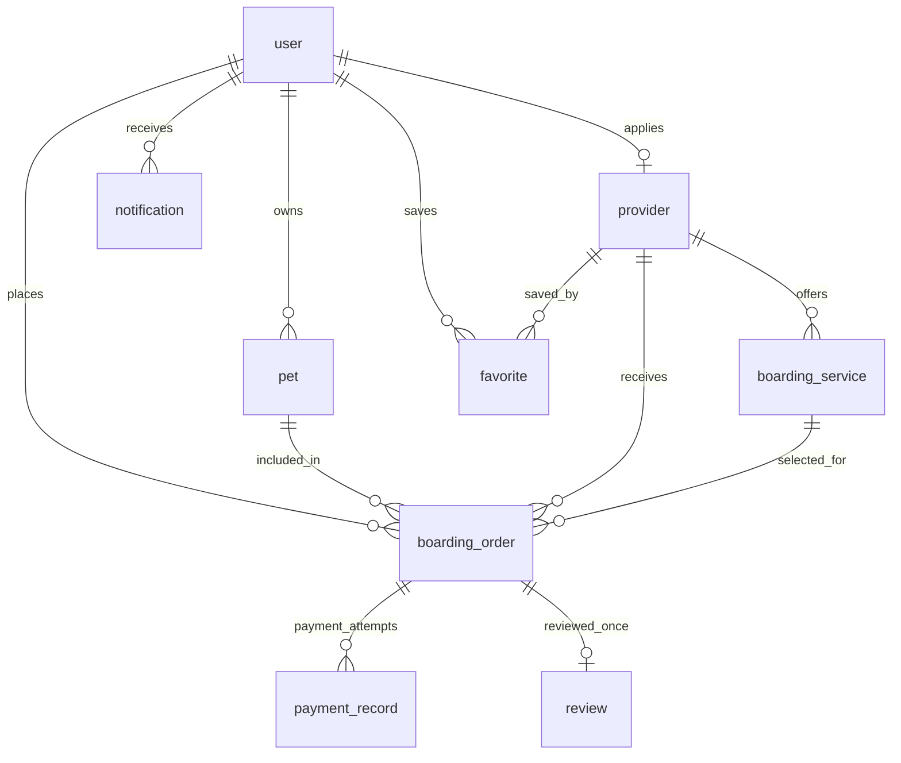

# V1.0 数据库设计

数据库名：`pet_boarding`。MySQL 8、InnoDB、`utf8mb4_0900_ai_ci`。主键为应用生成的 `BIGINT`；所有时间字段为 `DATETIME`。业务日期按中国标准时间解释，订单区间采用 `[start_at, end_at)`，入店日含、离店日不含。后续 API 层需要明确时区并统一转换。`pet.character` 字段在 MySQL 查询中必须加反引号，实体映射已按此处理。

## 表与关系

| 表 | 主体 | 关键唯一约束 | 常用索引 |
| --- | --- | --- | --- |
| `user` | 微信用户 | openid、可选 unionid | phone |
| `pet` | 用户宠物 | 主键 | user + 删除标记 |
| `provider` | 商家申请和资料 | owner_user_id | 审核状态 + 创建时间 |
| `boarding_service` | 商家寄养服务 | 主键 | 商家 + 状态；宠物类型 + 状态 + 价格 |
| `boarding_order` | 寄养订单 | order_no | 用户/商家 + 状态 + 时间 |
| `payment_record` | 微信支付尝试 | out_trade_no、微信交易号 | 订单 + 状态 |
| `review` | 完成订单后的评价 | order_id | 商家/服务/用户 + 创建时间 |
| `favorite` | 用户收藏商家 | user_id + provider_id | provider_id |
| `notification` | 用户站内通知 | 主键 | 用户 + 已读状态 + 创建时间 |

## 状态与金额

- `provider.audit_status`：0 待审核、1 已通过、2 已拒绝。
- `boarding_service.status`：0 下架、1 上架。
- `boarding_order.status`：0 待付款、1 待确认、2 寄养中、3 已完成、4 已取消。
- `payment_record.status`：0 已创建、1 已支付、2 失败、3 已关闭、4 已退款。
- `boarding_order.unit_price` 和 `total_amount` 是下单时快照；`payment_record.amount` 是本次支付请求金额。所有金额单位为人民币元。
- 一个订单可有多条支付尝试，但支付成功只能推动订单状态一次。`out_trade_no` 与微信交易号的唯一索引支持回调幂等；服务层仍须以事务和条件更新核验金额及状态。

## 服务层必须执行的约束

外键无法表达以下跨行和跨表规则，后续服务层需在事务中校验：

1. 订单的 `pet.user_id` 必须等于 `boarding_order.user_id`，`boarding_service.provider_id` 必须等于 `boarding_order.provider_id`。
2. 审核通过且上架的服务才可下单；宠物类型应与服务支持类型匹配。
3. 每个服务的同日有效订单数不能超过 `capacity`；支付和确认时需对并发预订进行锁定或等效串行化处理。
4. 仅已完成且属于当前用户的订单可评价，且一个订单只能有一条评价。
5. 仅允许合法订单状态流转；取消和退款要分别记录，退款不会改变订单历史金额。
6. 用户删除宠物时使用 `is_deleted` 软删除，保留订单引用；商家和服务下架也不删除历史订单。

## 后续扩展

美容、接送、商城、会员等新业务可新建领域表，共用用户、商家、支付和通知基础设施。AI 健康分析和社区数据应单独建表，避免在宠物档案或订单表堆积无关字段。
